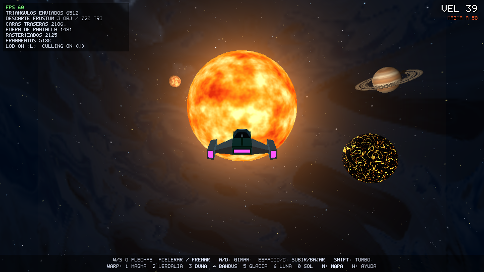
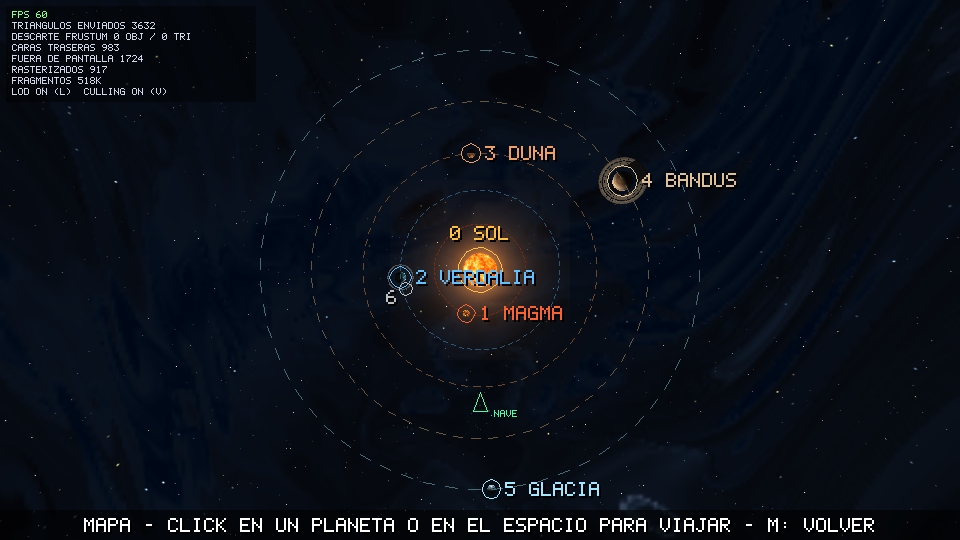

# Proyecto final: sistema solar con renderizador por software

Un pequeño sistema solar que se explora con la nave que modelamos en Blender. Todo el 3D (transformaciones, recorte, rasterizado, profundidad y shaders) está hecho a mano en Rust. `minifb` solo abre la ventana, lee el teclado y el mouse y muestra el framebuffer; cumple el mismo papel que raylib en el enunciado.





## Ejecutar

```bash
cargo run --release
```

Hay que compilar en modo `--release`: en modo debug el renderizador es unas 20 veces más lento.

## Controles

| Tecla | Acción |
|---|---|
| `W` / `↑` | Acelerar |
| `S` / `↓` | Frenar (y reversa lenta) |
| `A` `D` / `←` `→` | Girar |
| `Espacio` / `E` | Subir |
| `C` / `Q` | Bajar |
| `Shift` + `W` | Turbo |
| `1`–`6`, `0` | Warp: 1 Magma, 2 Verdalia, 3 Duna, 4 Bandus, 5 Glacia, 6 Luna, 0 Sol |
| `M` / `Enter` | Abre o cierra el mapa del sistema. En el mapa, un clic en un planeta o en el espacio lleva la nave ahí |
| `L` | Activa o desactiva los niveles de detalle (LOD) |
| `V` | Activa o desactiva el descarte por frustum |
| `H` | Muestra u oculta los controles en pantalla |
| `Tab` | Muestra u oculta el panel de detalles (FPS y contadores de triángulos) |
| `Esc` | Salir |

## Recorrido sugerido para la demo

1. Al iniciar, la nave mira hacia el sol. Acelera con `W` y gira con `A`/`D`.
2. Presiona `2` para hacer warp a Verdalia. Al llegar se activa la **órbita local** y puedes rodear el planeta y su luna.
3. Aléjate con `W` + `Shift`.
4. Abre el mapa con `M` y haz clic en Bandus para ver sus anillos.

## Cómo funciona el pipeline ([src/renderer.rs](src/renderer.rs))

Cada objeto se dibuja con `frame.draw(malla, uniforms, shader, cull)`. `uniforms.model` contiene la matriz del objeto actual. Antes de dibujar el siguiente objeto se cambian esa matriz y el shader activo, que es un puntero a función (`FragmentShader`).

1. **Descarte por frustum:** la esfera envolvente del objeto se prueba contra los 6 planos de la cámara. Si queda fuera, no se procesa ni un triángulo.
2. **Vertex shader:** transforma de modelo a mundo a vista a clip (`projection * view * model`) y prepara los datos que se interpolan (posición de mundo, normal, posición local y color).
3. **Recorte** contra el plano cercano (un triángulo puede convertirse en dos), seguido de la división de perspectiva y la matriz de viewport.
4. **Descarte de caras traseras** y de triángulos fuera de pantalla.
5. **Rasterizado en paralelo:** la pantalla se divide en bandas de 8 filas y los hilos van tomando bandas de una cola, así los núcleos rápidos hacen más trabajo. Para cada píxel se calculan las coordenadas baricéntricas y se hace la prueba de profundidad: el z-buffer guarda 1/w y lo más grande es lo más cercano. Luego se interpolan los datos con corrección de perspectiva y se llama al fragment shader.

Las matrices `look_at`, `perspective` y `viewport` están escritas a mano en [src/math.rs](src/math.rs).

## Escena

- **Sol y planetas** ([src/scene.rs](src/scene.rs)): matriz de modelo = `traslación(órbita) * inclinación * rotación(t) * escala(radio)`. La Luna orbita alrededor de Verdalia porque su posición parte de la de su planeta. Todo depende del tiempo transcurrido.
- **Nave:** se carga desde `models/nave_espacial.obj` con los colores de su `.mtl`, con sombreado plano. Los motores (material `Brillo_Motor`) son emisivos.
- **Cámara en tercera persona:** el objetivo de `look_at` es el centro de la nave y la cámara se mantiene a una distancia constante detrás de ella, siguiendo su orientación con un pequeño retraso.
- **Cielo** ([src/sky.rs](src/sky.rs)): una esfera de radio 4000 que contiene todo el sistema, con un fragment shader sin iluminación. Es nuestro shader de nebulosa (`nebula.frag`) portado a CPU, más dos capas de estrellas que parpadean. La nebulosa es costosa, así que se hornea en un cubemap animado: se mezclan dos cuadros clave mientras el siguiente se calcula unas filas por frame.
- **Efecto de turbo:** mientras se usa el turbo, el shader del cielo cambia. La nebulosa se deforma con ondas que viajan desde el punto de fuga, aparecen estelas de luz que salen del centro (carriles en coordenadas polares que se desplazan con el tiempo), los bordes se tiñen de azul y el FOV se abre un poco.
- **Warp con "pantalla de carga":** al viajar, un iris se cierra sobre la nave con estelas de velocidad y el FOV se abre. Con la pantalla en negro la nave se teletransporta al lado iluminado del destino y el iris se vuelve a abrir. Nunca se cambia de escena.

## Características del menú que solicitamos evaluar

| Característica | Dónde verla |
|---|---|
| Planetas distinguibles (Magma, Verdalia, Duna, Bandus, Glacia y la Luna) | Teclas `1`–`6` |
| Shaders propios: sol, magma, verdalia, duna, bandus, anillos, glacia, luna, nave y cielo | [src/shaders.rs](src/shaders.rs) |
| Shaders animados: plasma del sol, lava que pulsa, nubes de Verdalia, bandas de Bandus, nebulosa, estrellas y estelas del turbo | Cualquier vista; `Shift` + `W` para el turbo |
| Etapa propia de generación/subdivisión de geometría (icosfera) | `icosphere` en [src/mesh.rs](src/mesh.rs) |
| Modo de control local (la nave acompaña al planeta en su órbita) | HUD: "ORBITA LOCAL" |
| Aceleración, frenado y giro progresivos e independientes de los FPS | [src/scene.rs](src/scene.rs), `Ship::update` |
| Colisión básica con planetas y sol | Intenta atravesar un planeta |
| Descarte de objetos fuera de la vista | Contadores del HUD; compara con `V` |
| Niveles de detalle según la distancia (20 a 20 480 triángulos) | Contadores del HUD; compara con `L` |

El panel de detalles (`Tab`) muestra los triángulos enviados, los descartados por frustum, las caras traseras, los fuera de pantalla, los rasterizados y los fragmentos sombreados.

## Parámetros fáciles de cambiar en vivo

- Radio, órbita, velocidades y parámetros de shader de cada cuerpo: `solar_system()` en [src/scene.rs](src/scene.rs). Por ejemplo, `params[0]` del sol es la velocidad de su animación y `params[0]` de Magma es la intensidad de la lava.
- Semillas del ruido: el último argumento de `fbm`, `perlin` y `voronoi` en [src/shaders.rs](src/shaders.rs).
- Física de la nave: las constantes `THRUST`, `DRAG`, `TURN_MAX`, etc. en [src/scene.rs](src/scene.rs).
- Velocidad de la nebulosa: `NEBULA_SPEED` en [src/sky.rs](src/sky.rs).

## Capturas y pruebas sin ventana

```bash
# Imagen después de hacer warp a Bandus (tecla 4) en t = 20 s
cargo run --release -- --screenshot shot.bmp --time 20 --warp 4
# Mapa del sistema
cargo run --release -- --screenshot mapa.bmp --map
# Medir el tiempo por frame
cargo run --release -- --bench 120
```

## Integrantes y contribuciones

- _(nombre)_: _(contribución)_

## Recursos externos y uso de IA

- [minifb](https://crates.io/crates/minifb) para la ventana y la entrada, y [nalgebra-glm](https://crates.io/crates/nalgebra-glm) para los vectores y matrices.
- El shader de nebulosa está basado en un shader inspirado en Balatro (`myShader.js`), portado a Rust.
- Usamos asistencia de IA (Claude) para escribir parte del código; lo revisamos y podemos explicarlo.
