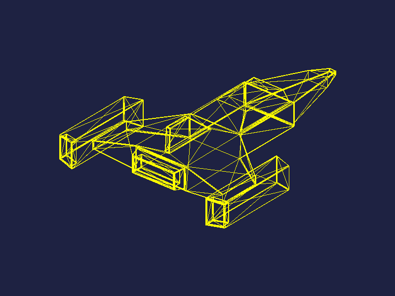

# Carga de Modelos

Software renderer en Rust que carga un modelo `.obj` (la nave espacial hecha en Blender en el lab anterior) y lo dibuja en pantalla usando una función propia para pintar triángulos.



## Cómo funciona

1. **Carga del modelo** ([src/obj.rs](src/obj.rs)): se leen las líneas `v` (vértices) y `f` (caras) del archivo. De cada cara se toman los índices de sus vértices (en el `.obj` empiezan en 1, aquí se pasan a base 0).
2. **Ajuste a la pantalla** ([src/main.rs](src/main.rs), `fit_to_screen`): los vértices se rotan para ver la nave en tres cuartos y luego se escalan y trasladan para que quede centrada y ocupe aproximadamente el 70% de la ventana.
3. **Dibujo** ([src/main.rs](src/main.rs), `render`): se recorren las caras manualmente. Con los índices de cada una se buscan sus vértices y se dibuja un triángulo. Las caras de 4 o más vértices se dividen en triángulos en abanico: `(0,1,2)`, `(0,2,3)`, etc.
4. **Triángulos** ([src/triangle.rs](src/triangle.rs)): un triángulo son tres líneas entre sus vértices, trazadas con el algoritmo de Bresenham ([src/line.rs](src/line.rs)) sobre el framebuffer ([src/framebuffer.rs](src/framebuffer.rs)).

## Modelo

`models/nave_espacial.obj`: 622 vértices y 620 caras, exportado desde Blender.

## Ejecutar

```bash
cargo run --release
```

Abre una ventana de 800×600 con el modelo. Se cierra con `Esc`.

Para regenerar la imagen del README:

```bash
cargo run --release -- --screenshot render.bmp
sips -s format png render.bmp --out render.png   # en macOS
```

También se puede pasar otro modelo: `cargo run --release -- ruta/al/modelo.obj`.

## Dependencias

- [minifb](https://crates.io/crates/minifb): ventana y despliegue del framebuffer
- [nalgebra-glm](https://crates.io/crates/nalgebra-glm): vectores y matrices
